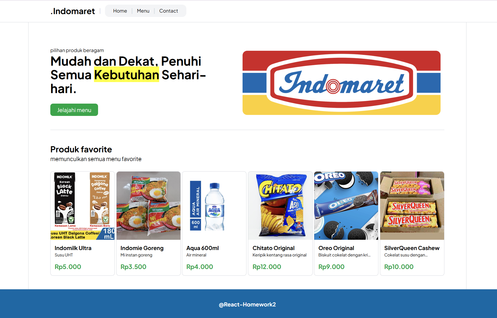
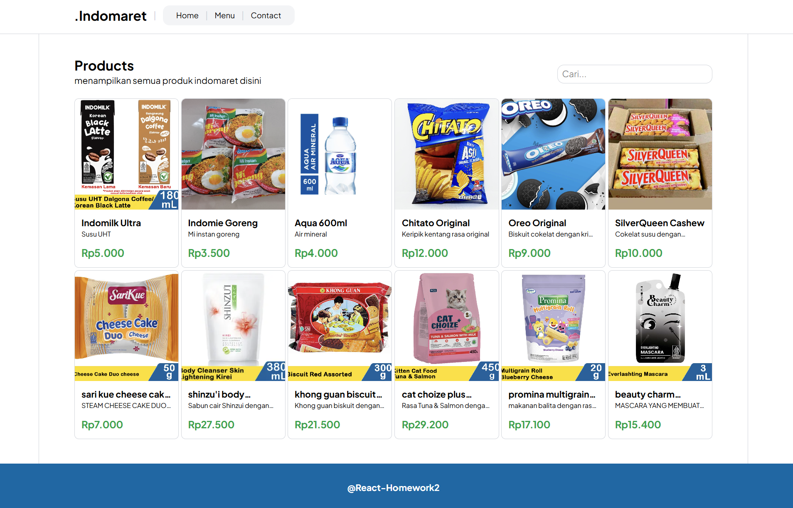
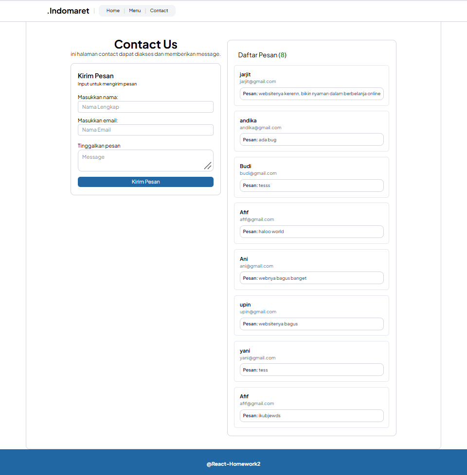

## Deskripsi

.indomaret adalah tugas react homework yang dibangun menggunakan react dan tailwindcss.
website ini terdiri dari 3 menu, yaitu menu home menampilkan informasi usaha dan menu favorite, halaman menu menampilkan semua produk dan user dapat mencari nama produk dengan input search pada halaman tersebut, dan terakhir menu contact untuk mengirimkan pesan melalui contact website.

Implementasi di dalam tugas ini mencakup:

- Implementasi install react js : npm create vite@latest -- --template react
- Intall tailwindcss: npm install tailwindcss @tailwindcss/vite lalu menambahkannya pada vite.config dan index.css
- Penerapan tailwindcss pada class html dalam desain tampilan ui
- Implementasi React komponent sehingga development didalamnya dapat di handle dengan baik dan juga digunakan sesuai kebutuhan
- Implementasi penggunaan Props dalam menerima data yang diberikan oleh komponent parentnya
- Implementasi state dalam react untuk set datanya sehingga dapat disimpan didalam memori program sementara dan dapat di get atau ditampilkan datanya yang tersimpan
- Penerapan useEffect untuk memberikan efek lain yang akan dieksekusi program
- Penerapan event handler seperti onSubmit dan onChange pada form dengan membuat sebuah callback/function sehingga event dapat dijalankan dan memberikan proses even serta menangkap data yang di lakukan user pada website.
- Implementasi penggunaan React Route: npm install react-router dan menerapkannya dengan Route path pada function parent (App) lalu memanggilnya menggunakan < Link to=""> sebagai pengganti anchor pada tag html
- Implementasi penyimpanan menggunakan Local Storage pada form inputan

Terdapat 3 Halaman:

- Home: Informasi usaha dan menu favorite
- Menu: Menampilkan semua produk dan seacrh nama produk
- Contact: berisi form inputan contact

Fitur:

- Search Menu
- Contact Form (Local Storage)

## Tampilan Website

### Halaman Home



### Halaman Menu



### Halaman Contact



## Alur Penggunaan

#### User Mengunjungi Alamat/domain website

- Menampilkan halaman Home
- Pada halaman home terdapat hero section menampilkan informasi usaha dan menu favorite
- pengguna dapat melihat menu menu andalan atau favorite pada halaman ini

#### User klik navigasi "Menu"

- Menampilkan halaman semua produk
- pada halaman ini semua produk ditampilkan
- pengguna dapat mencari produk yang ingin dicari dengan mengetikan nama pada pencarian/search pada halaman, setelah input pencarian sistem akan memunculkan produk yang dicari pengguna

#### User klik navigasi "Contact"

- Menampilkan form inputan contact yang dapat dikirimkan ke sistem dan dapat baca nantinya
- pengguna dapat memasukan nama, email dan pesan yang ingin disampaikan lewat website

## Cara Menjalankan Project

#### Cara menjalankan project ini adalah dengan menginstall npm terlebih dahulu agar dapat menjalankan run development reactnya nanti/ build semua library dalam developmentnya

```bash
npm install
```

#### Setelah npm install maka jalankan development reactnya menggunakan npm run dev

```bash
npm run dev
```
